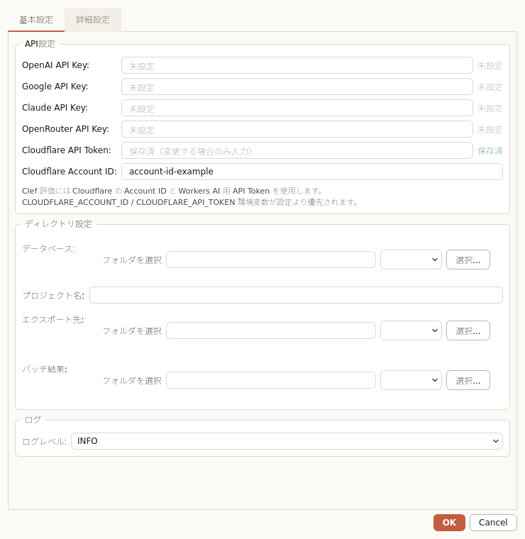
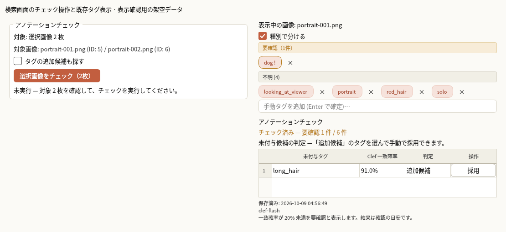
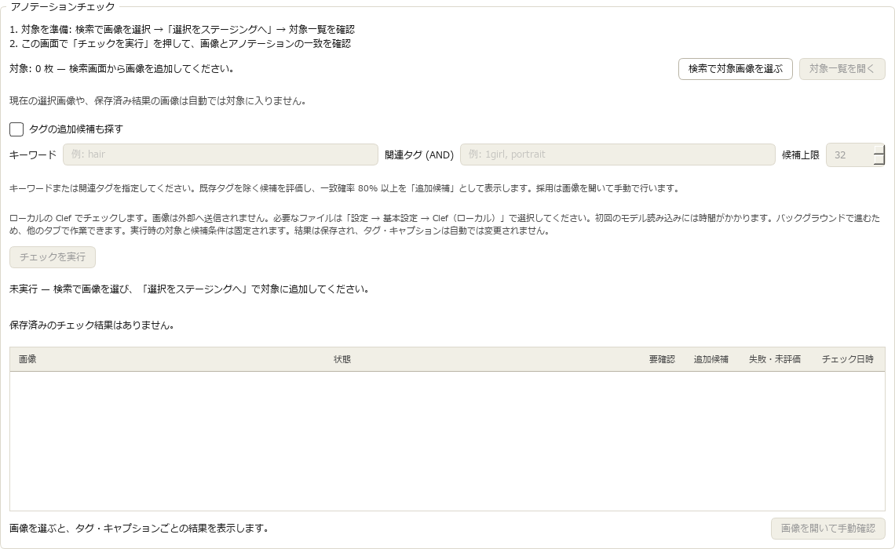

# Clef によるアノテーションチェック

ローカルで動作する Clef モデルを使い、登録済みの画像とタグ・キャプションを照合する機能である。たとえば犬が写っていない画像の `dog` タグや、赤髪の人物を青髪と説明するキャプションを、個別の確認候補として表示する。判定はあくまで参考情報であり、修正するかどうかはユーザーが判断する。

## 選択画像をチェックする

### 基本手順

1. 「設定」から「基本設定」を開き、**Clef(ローカル)** を選択する。
2. 「参照」ボタンから **実行ファイル(llama-server)**、**モデル GGUF**、**画像プロジェクター GGUF(mmproj)** を指定して保存する。
   - Clef の `/v1/systemone` に対応する llama.cpp と、組み合わせが一致するモデルおよび mmproj を使用する。
   - 動作確認済みの組み合わせは、llama.cpp b11435、Clef-flash 9B Q4_K_M、mmproj Clef-flash BF16 である。
3. 「検索」画面でタグまたはキャプションが付いた画像を選ぶ。複数選択にも対応している。
4. サムネイル下の **「選択画像をチェック(N枚)」** を押し、対象一覧を確認してから開始する。
5. 準備中表示、処理枚数、保存結果を確認する。開始後に選択を変更しても、処理対象は開始時の画像に固定される。
6. 既存タグの枠と **!** が付いた項目を画像と見比べ、必要に応じてタグやキャプションを手動で修正する。

### ローカル実行の仕様と制約

- **モデルの遅延起動と再利用**: 画像を選択しただけではモデルを起動しない。初回のチェック時にモデルを読み込み、2回目以降は同じローカル実行プロセスを再利用する。初回の読み込みには時間がかかる。
- **完全ローカル処理**: 画像、タグ、キャプションはこの PC 内で処理する。Cloudflare のホスト API、Account ID、API Token は使用せず、ホスト API への切り替えやフォールバックも行わない。
- **実行リソースと前提ファイル**: GPU 層数の既定値は 10、コンテキスト長は 4096 である。GPU 層数を 0 にすると CPU で実行する。モデルファイルの自動ダウンロード機能はないため、上記 3 ファイルは事前に用意する。
- **異常時の挙動と終了処理**: 実行時にモデルとプロジェクターの組み合わせが合わない場合や、コンテキスト長が不足する場合は失敗として表示する。ローカル実行プロセスはアプリ終了時に停止する。

### 設定ファイルの例

設定ファイル `config/lorairo.toml` の記述例を以下に示す(各パスは実際の保存先に合わせる)。

```toml
[annotation_review]
model = "clef-flash"
server_path = "models/clef/llama-runtime/llama-server.exe"
model_path = "models/clef/Clef-Flash-Q4_K_M.gguf"
mmproj_path = "models/clef/mmproj-Clef-Flash-BF16.gguf"
n_gpu_layers = 10
context_size = 4096
warning_threshold = 0.2
suggestion_threshold = 0.8
timeout = 300.0           # ローカル起動・推論それぞれの待機上限(1–3600秒)
```

GUI では絶対パスでの指定を推奨する。相対パスを指定した場合、通常はアプリのルートを基準に解決する。CLI で明示指定した場合は `--workspace`(省略時は明示した設定ファイルの親ディレクトリ)を基準に解決する。評価対象は元画像(クロップ画像の場合はそのクロップ画像)と有効な注釈であり、ソフトリジェクト済みの注釈は含めない。

### CLI からの実行

CLI では対象 ID を明示して実行する。

```bash
lorairo-cli --read-only review run --project my_dataset --image-ids 12,34
lorairo-cli --json review run --project my_dataset --image-ids-file ids.txt
lorairo-cli --json review run --project my_dataset --crop-children-of 42
lorairo-cli --json review run --project my_dataset --crop-children --save-results
```

対象指定と制限事項は以下のとおりである。

- **クロップ子画像の指定**: `--crop-children-of <親 ID>` は指定した親画像から切り出したクロップ子画像のみを対象にする。`--crop-children` はプロジェクト内の全クロップ子画像を `crop_relations` から解決して確認する。親画像や無関係の画像は含めない。
- **排他指定と 0 件時の挙動**: ID 指定、ID ファイル、2 種類のクロップ指定は同時に使えない。子画像が 0 件のときは「対象 0 件」を表示し、終了コード 0 で終了する。存在しない親 ID を指定した場合は `NOT_FOUND` になる。
- **件数上限**: 1 回につき最大 500 枚まで確認できる。ID ファイルを使う場合も上限は同じで、超過時はモデル起動や画像読み込みの前に `RESULT_SET_TOO_LARGE` で拒否する。クロップ子画像はプロジェクトを開いてから解決するため、500 枚の上限はプロジェクトを開いた後、Clef への問い合わせと結果保存の前に判定する。
- **出力と終了コード**: 個々の候補に対し、画像 ID、注釈 ID、種別、原文、状態、一致確率を返す。候補がない画像は未評価として報告し、モデルを起動しない。警告があっても正常に判定できた場合の終了コードは 0 である。ローカル起動、推論、応答解析の失敗、古い判定、中止、または `--save-results` 時の保存失敗がある画像を含む場合、他の画像を確認(保存指定時は保存)できていれば終了コード 3(部分成功)、1 枚も処理できなければ 1 を返す。引数に誤りがある場合は 2 を返す。

## 一致確率と状態

一致確率は「このタグ・キャプションの内容が画像に支持されている」という質問が真である確率を表す。たとえば `0.03` は画像との一致度が低い判定であり、既定では `0.2` 未満を「要確認」とする。ちょうど `0.2` の場合は警告対象外である。基準値は設定で変更できるが、一般的な正解率を保証する値ではない。警告がないことも、注釈の正確さを保証するものではない。

| 状態 | 意味 |
|---|---|
| 要確認 | 一致確率が設定した基準を下回る |
| 警告対象外 | 評価が成功し、一致確率が基準以上である |
| 失敗 | モデル設定、起動、推論、画像入力、応答解析などの問題で評価できなかった |
| 未評価 | 候補がない、キャンセルされた、または前のリクエスト失敗により処理されなかった |
| 古い結果 | 画像ファイル、注釈、または判定設定が変わったため、再確認が必要である |

ローカルモデルのコンテキスト長に収めるため、注釈は最大 16 件ずつに分割して評価する。途中で失敗した場合はそれまでの成功結果を残し、失敗した部分と未評価の部分を区別する。自動再試行は行わない。確認中にキャンセルすると次の評価を停止するが、進行中の起動や推論は完了またはタイムアウトまで待機する場合がある。

## 複数画像の確認と結果の保存

### 検索画面・結果タブからの一括チェック

検索画面からは、選択した画像をそのままチェックできる。1 枚から最大 500 枚まで、対象の枚数と名前を確認してから開始する。「中止」を押すと次の評価を停止する。完了した画像から順に結果をプロジェクト DB へ自動保存し、保存済みの枚数と保存失敗件数を表示する。保存に失敗した画像は、チェック・保存完了としては扱わない。

ステージ済み画像をまとめて処理する手順は以下のとおりである。

1. 「結果」タブの「検索で対象画像を選ぶ」から検索画面を開く。
2. 画像を選択し、「選択をステージングへ」を押す。
3. 「結果」タブに戻り、表示された対象枚数とファイル名を確認する。必要に応じて「対象一覧を開く」からステージ済み画像を確認・削除する。
4. 「チェックを実行」を押して処理を開始する。

現在の選択画像や保存済み結果の画像が自動的に対象へ入ることはない。1 回の対象上限は最大 500 枚である。開始時の画像 ID を固定し、バックグラウンドで画像と有効なタグ・キャプションの状態を読み取ってからローカルで評価する。実行中に別の画像を選択したり、ステージングを変更したりしても、実行中の対象は変わらない。

### DB への保存規則と鮮度管理

画像ごとに最新の確認結果をプロジェクト DB に保存するため、画像を切り替えたりアプリを再起動したりしても結果は残る。保存内容には、元の注釈 ID、文章、一致確率、警告や失敗の状態、判定モデル、判定基準、確認時刻が含まれる。途中で中止しても、それまでに完了した画像の結果は失われない。

CLI における保存の挙動は以下のとおりである。

- **明示指定時のみ保存**: 既定では保存せず読み取り専用で動作する。`--save-results` を明示したときだけ、GUI と同じ規則で結果を保存する。保存した結果は、結果画面と検索の「要確認」にそのまま反映される。
- **読み取り専用オプションとの排他**: ルートの `--read-only` と `--save-results` は併用できず、`INVALID_INPUT` エラーとなる。
- **書き込みモードでのプロジェクトオープン**: `--save-results` 指定時は、クロップ子画像の解決も含め、他の書き込みコマンドと同じ方法でプロジェクトを開く。そのため、子画像が 0 件や上限超過で評価を行わない場合でも、古い DB のマイグレーションや不足しているプロジェクト標準ディレクトリの作成は実行される(確認結果は保存しない)。
- **画像単位の確定と終了コード**: 保存は画像ごとに確定する。ある画像で DB ロックなどによる保存失敗が起きても、残りの確認と保存は継続する。保存に失敗した画像を含む場合の終了コードは 3、1 枚も保存できなかった場合は 1 となる。注釈、画像、reviewed 状態は変更しない。

「結果」画面では画像ごとの警告を確認し、手動確認の操作から検索画面の対象画像を開ける。結果一覧には直近の最大 500 枚を表示する。それ以前の結果も DB に保持されており、対象画像の詳細欄から確認できる。

タグやキャプションの修正は既存の手動編集操作で行う。画像、注釈、判定モデル、判定基準、モデル・プロジェクター・実行ファイル、GPU 層数、コンテキスト長のいずれかが変更された結果は「古い結果」として扱い、現在の内容に対する一致確率としては表示しない。

結果の保存には `annotation_review_results` テーブルを使用する。既存の DB は通常の Alembic マイグレーションによって更新される。保存対象は確認結果のみであり、既存の注釈、confidence、品質スコア、reviewed 状態、出力対象は変更しない。また、文法の専用チェック、好みの予測、自動修復、出力対象の自動除外はこの機能の対象外である。

## 検索から確認・修正する

### サムネイル表示と絞り込み

検索サムネイルには保存済みの判定結果を表示する。「要確認 3件」などの印が付いた画像を選択し、詳細欄で該当するタグやキャプションを確認する。

検索条件の「要確認あり」を使うと、現在の画像・注釈・判定設定に一致する警告を持つ画像だけを絞り込める。古い判定は絞り込み対象に含めない。未チェック、未評価、失敗、部分失敗、古い判定は、警告なしの状態と明確に区別する。検索時には保存済み結果の取得と鮮度確認だけを行い、モデルの起動や推論は実行しない。チェック処理が完了した画像は、順次サムネイルと選択中の詳細欄へ反映される。

### 既存タグとキャプションの警告表示・編集

- **タグの警告表示**: 要確認の既存タグは、枠と小さな **!** で表示し、タグの選択状態と区別する。問題のないタグは通常どおり表示する。タグにポインターを重ねると、取得済みの一致確率、判定モデル、対象注釈をツールチップで確認できる。独立した既存タグのチェック結果表は設けず、画像全体の判定状態と確認時刻は詳細欄に表示する。画像切り替えや再起動後は保存結果を照合して表示を復元し、表示のためにモデルを実行することはない。
- **種別グループ分けとの連携**: 「種別で分ける」を有効にすると、先頭に **「要確認(N件)」** グループが現れる。警告タグはこのグループだけに表示し、元の種別グループには重複表示しない。タグ本来の種別情報は保持される。通常の種別が 1 種類のみの場合でも利用でき、グループ表示を切り替えても警告の枠・記号・ツールチップは維持される。古い判定や失敗は現在の警告に混ぜない。
- **手動編集と結果の無効化**: 要確認のタグは既存の手動タグ操作で修正する。キャプション欄には有効な全キャプションを注釈行ごとに表示し、各行の「編集」から文章を変更して保存できる。保存時には対象行 ID と編集前の文章を照合し、すでに変更された文章を古い編集画面で上書きしないようにする。保存後は手動編集フラグを設定し、元のモデル情報と行 ID は保持する。編集を行うとチェック結果は古い判定になり、一致確率の表示や追加候補の採用操作は無効になる。なお、強調表示はタグまたはキャプション全体に対するものであり、説明文の生成や単語単位の問題箇所の指摘は行わない。

## 関連画像群から未付与タグを提案する

### 候補の収集条件

結果タブで「タグの追加候補も探す」を選び、候補を集める画像群のキーワードまたは関連タグを指定する。複数タグを指定した場合は AND 条件となる。キーワードとタグの両方が空の状態では実行できない。

集計には既存のタグクラウドと同じ仕組みを利用し、1 画像に同じタグが複数あっても 1 件として数える。頻度順の候補から対象画像にすでに付いているタグを除き、指定件数を各画像へ渡す。指定件数の既定値は 32 件、最大値は 64 件であり、タグクラウドの表示ノード数とは独立している。

### 評価と採用の仕様

開始時に対象画像 ID と候補条件を固定し、全画像の注釈と未付与候補を準備してから評価を行う。既存タグの一致確率が `warning_threshold` 未満なら「要確認」、未付与候補の一致確率が `suggestion_threshold` 以上なら「追加候補」と判定する。追加候補は警告件数に含めない。候補外、評価失敗、未評価も結果上で区別し、判定内容、候補条件、追加基準を保存する。旧形式の保存結果もそのまま読み込めるため、この拡張に伴う追加の DB マイグレーションは不要である。

対象枚数と処理内容を確認して「チェックを実行」を押すと、直ちに準備中表示に切り替わる。進捗と実行中の状態は別タブへ移動しても確認できるが、所要時間の予測は表示しない。

詳細欄の追加候補には「採用」ボタンがあり、選んだ候補だけを手動タグとして登録できる。採用時には最新の保存結果と画像・注釈・設定を再確認し、古い候補や置き換わった結果は採用しない。一致確率をタガーの confidence や手動スコアへ書き込むことはなく、reviewed 状態も変更しない。

## 表示例

以下の画面例に表示されている結果は、表示確認用の架空データである。







## ライブラリとの境界

`image_annotator_lib.decisions` は `annotate()` とは別の公開 API である。`LocalDecisionClient` が llama.cpp のローカルプロセスを管理し、真偽判定、候補選択、段階評価の型定義と検証を担当する。通信先は内部で起動したループバック上のプロセスに固定し、アプリが生成する一時キーで接続を確認する。外部 URL、ユーザーの API キー設定、プロキシ、リダイレクトは使用しない。

一方、LoRAIro 側は DB の注釈 ID を質問 ID(`tag_123` や `caption_456`)に対応付け、質問文の組み立て、警告基準の適用、画面表示、編集後の無効化を担当する。通常の annotation モデル選択や `AnnotationSaveService` へ判定結果を流すことはない。

### 関連リンク

- 設計判断: [ADR 0094](decisions/0094-clef-annotation-review.md)、[ADR 0095](decisions/0095-clef-review-batch-results.md)、[ADR 0096](decisions/0096-clef-search-tag-suggestions.md)、[ADR 0097](decisions/0097-clef-local-only.md)(実行方式は ADR 0097 が旧 API 方針を置き換える)
- 関連 Issue: [LoRAIro #1366](https://github.com/NEXTAltair/LoRAIro/issues/1366)、[image-annotator-lib #167](https://github.com/NEXTAltair/image-annotator-lib/issues/167)
- モデル: [Clef-flash](https://huggingface.co/Cloudflare/clef-flash)
- ローカル実行: [llama.cpp](https://github.com/ggml-org/llama.cpp)
