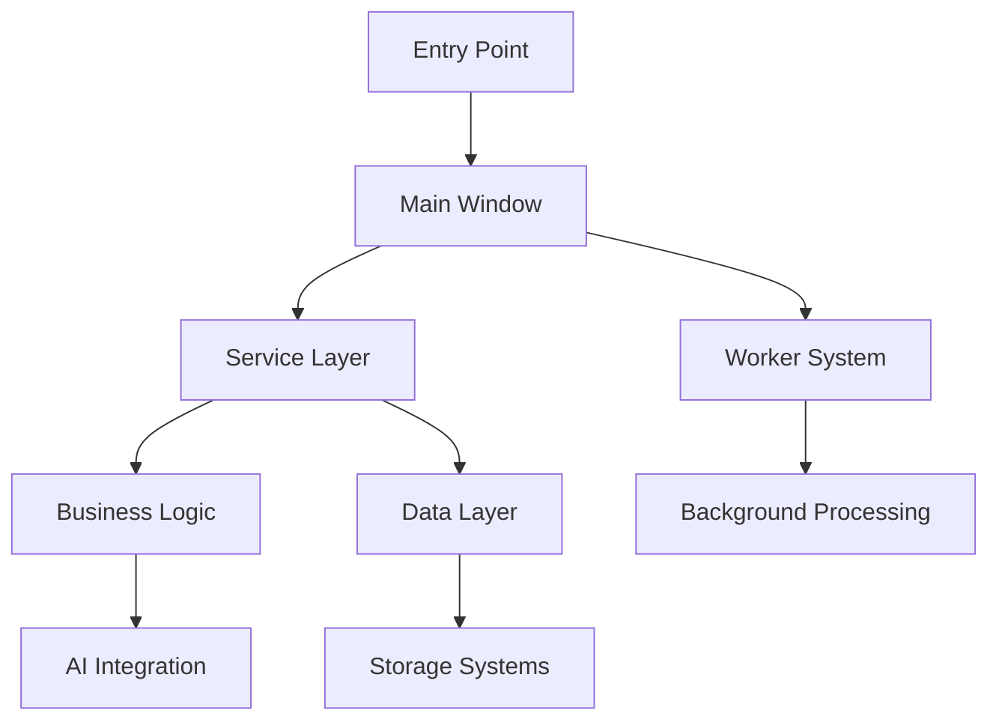
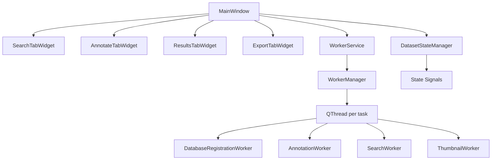

# LoRAIro アーキテクチャドキュメント

## システム概要

LoRAIro は、機械学習用データセットの作成を支援する AI 画像アノテーションおよびデータセット管理アプリケーションである。責務を明確に分けた 3 層アーキテクチャで構成される。複数の AI プロバイダーによる画像処理に加え、学習データの品質評価と整備のための機能を備える。

## アーキテクチャ原則

### クリーンアーキテクチャ

本アプリケーションは、関心事の分離に基づくクリーンアーキテクチャを採用する。

- **プレゼンテーション層**: PySide6 ベースの GUI コンポーネントと QThread ワーカーシステム
- **アプリケーション層**: ビジネスロジックサービスとユースケース
- **ドメイン層**: 中核となるビジネスエンティティとルール
- **インフラストラクチャ層**: データベース、ファイルシステム、外部 API

### PySide6 ワーカーアーキテクチャ(更新: 2026-07-05)

非同期処理には `QThread` と `QObject.moveToThread()` を使用する。

- **WorkerManager**(`src/lorairo/gui/workers/manager.py`): タスクごとに `QThread` を生成し、ワーカーをそのスレッドへ移動する
- **LoRAIroWorkerBase**(`src/lorairo/gui/workers/base.py`): 進捗通知とキャンセル機能を備えた、`QObject` と Signal ベースの標準ワーカー基底クラス
- **専用ワーカー群**(`src/lorairo/gui/workers/`): データベース登録、アノテーション、検索、サムネイル生成などを担う各種ワーカー
- **WorkerService**(`src/lorairo/gui/services/worker_service.py`): ワーカーの調整と GUI 統合を担う Qt サービス層
- **DatasetStateManager**(`src/lorairo/gui/state/dataset_state.py`): Qt Signal を用いた集中状態管理

### 依存性注入

コンポーネントへサービスを注入する構成により、疎結合とテスト容易性を確保する。

### 設定駆動開発

システム全体の挙動は TOML ファイルで設定できる。コードを変更せずに動作をカスタマイズできる設計である。

### イベント駆動アーキテクチャ

コンポーネント間は Qt の Signal/Slot で通信し、疎結合と応答性の高い UI を両立する。

- **Qt 自動接続**: `on_buttonName_clicked` などの標準化されたシグナル命名規則を用いる
- **カスタムシグナル**: `DatasetStateManager` を介してコンポーネント間を連携する
- **ワーカーシグナル**: バックグラウンドスレッドから進捗更新と処理結果を通知する
- **状態同期**: Signal/Slot パターンにより集中管理された状態を各画面へ同期する

## システムコンポーネント

### 高レベルコンポーネント構成

### コンポーネント構成の要約

- **プレゼンテーション層**: PySide6 GUI と Qt ワーカーシステム
- **サービス層**: ビジネスロジックの調整(2 層構成)
- **データ層**: リポジトリパターンを用いた SQLite データベース
- **AI 統合**: マルチプロバイダー対応のアノテーションシステム

サービス一覧は `docs/services.md`、設計判断の記録は `docs/decisions/` を参照する。

### サービス層アーキテクチャ

サービス層は 2 層構成でビジネスロジックをカプセル化する。詳細は `docs/services.md` を参照する。

**ビジネスロジックサービス**(`src/lorairo/services/`):
- `SearchCriteriaProcessor`、`ModelFilterService`、`ImageProcessingService`、`ConfigurationService` などの Qt 非依存サービス群
- **`DatasetExportService`**: `export_with_criteria()` により、GUI・CLI・API の 3 経路からのエクスポートを統一インターフェースで処理する

**GUI サービス**(`src/lorairo/gui/services/`):
- `WorkerService`、`SearchFilterService` など

**設計判断**: `docs/decisions/0001-two-tier-service-architecture.md`、`docs/decisions/0009-qt-decoupling-design.md`

### データ層アーキテクチャ

データ層は以下のコンポーネントで永続化を担う。

**コアコンポーネント**:
- `DatabaseManager`(`src/lorairo/database/db_manager.py`)
- リポジトリパターン(`src/lorairo/database/repository/`)
- SQLAlchemy ORM とスキーマモデル(`src/lorairo/database/schema.py`)
- Alembic マイグレーションによる SQLite データベース管理

**主要エンティティ**:
- **Project**(`projects` テーブル): `id`、`name`、`path`、`description`、`created_at` を持ち、プロジェクト単位でデータセットを管理する
- **Image**(`images` テーブル): 外部キー `project_id` で `projects.id`(`ON DELETE SET NULL`)を参照し、画像をプロジェクトへ紐付ける

**設計判断**: `docs/decisions/0002-database-schema-decisions.md`、`docs/decisions/0012-batch-tag-atomic-transaction.md`

### GUI アーキテクチャ(更新: Epic #867)

GUI はタブ中心の設計と PySide6 ワーカーシステムを採用する。各タブは `src/lorairo/gui/tab/` 配下の専用合成ウィジェット(`search_tab.py`、`annotate_tab.py`、`results_tab.py`、`export_tab.py`、`jobs_tab.py`、`errors_tab.py`、`map_tab.py`、`cli_tab.py`)として実装し、`MainWindow` はそれらの接着剤として振る舞う。

**主要コンポーネント**:
- **MainWindow**(`src/lorairo/gui/window/main_window.py`): タブ統合を担う接着剤(Epic #867)
- **タブウィジェット群**(`src/lorairo/gui/tab/`): 1 タブにつき 1 つの合成ウィジェットとし、レイアウト・子ウィジェット・Signal 配線をそれぞれ所有する
- **状態管理**(`src/lorairo/gui/state/dataset_state.py`): `DatasetStateManager`
- **ワーカー統合**: `QThread` と `moveToThread()` による非同期処理

**ウィジェット構成の原則(必須)**:
- **各タブと画面は専用の合成ウィジェットへ分割する。** 検索タブ、アノテタブ、結果タブなどの 1 タブを 1 ウィジェットとし、自身のレイアウト・子ウィジェット・Signal 配線・固有の振る舞いを所有させる。
- **`MainWindow` は接着剤(オーケストレーター)に徹する。** 責務は、タブウィジェットの配置、サービスの注入、トップレベル Signal の接続に限定する。ピッカー起動、プリセット配線、実行バー構築、パイプライン構成といったタブ固有のロジックを `MainWindow` へ直接書かない。
- **再利用ウィジェットは `widgets/` に配置する。** 複数の画面で実際に共有されるものだけを切り出し(YAGNI)、`ds/` のような汎用部品ライブラリやサブパッケージを事前に作らない。
- **デザインとコードの整合は独立して管理する。** 整合性の維持は `theme.py` のトークン一致(#782)と `docs/design/lorairo-design-system/`(Claude Design ミラー)が担う。Qt ウィジェットの配置構成はこれと独立させる。
- **根拠**: `MainWindow` の肥大化再発を防ぎ、Qt のウィジェット分割と合成を低コストに保つためである([[feedback_qt_widget_extraction_cheap]]、`docs/lessons-learned.md` の「GUI オーケストレーターは接着剤に留める」)。実装手順は `lorairo-qt-widget` スキルを参照する。

**設計判断**: `docs/decisions/0011-mainwindow-ui-redesign.md`

### ワーカーアーキテクチャ(PySide6 QThread システム)

非同期処理の中核は `QThread` と `QObject.moveToThread()` である。`QRunnable` と `QThreadPool` は主系のワーカーシステムではなく、ウィジェット局所のデバウンス補助(`widgets/count_estimate.py`、`widgets/tag_suggestion.py`)の 2 箇所でのみ使用する。

**主要コンポーネント**:
- **WorkerService**(`src/lorairo/gui/services/worker_service.py`): 高レベル API
- **WorkerManager**(`src/lorairo/gui/workers/manager.py`): `QThread` のライフサイクル管理
- **LoRAIroWorkerBase**(`src/lorairo/gui/workers/base.py`): `QObject` と Signal ベースの標準ワーカー
- **専用ワーカー群**: データベース登録、アノテーション、検索、サムネイルの各ワーカー

**主な機能**: 進捗報告、キャンセル対応、エラーハンドリング、状態管理との統合

### AI 統合アーキテクチャ

`image-annotator-lib` を介して、OpenAI、Anthropic、Google、OpenRouter、およびローカル ML モデルに対応する。

**主要コンポーネント**:
- **AnnotationWorker**: AI アノテーションの主要な調整役
- **image-annotator-lib**: マルチプロバイダー統一インターフェース
- **ローカルモデル**: CLIP、DeepDanbooru、ONNX、TensorFlow をサポート

**WebAPI 推論経路の責務分離(ADR 0023 Phase 1)**:
- **モデル検出と能力メタデータ**: LiteLLM 同梱データベースを実行時の SSoT とする(`available_api_models.toml` キャッシュは廃止)
- **推論実行**: マルチモーダル入力、構造化出力、出力リトライは PydanticAI のネイティブなプロバイダー・モデルが担う
- **識別子マッピング**: LiteLLM ID と PydanticAI 実行記述子の対応付けは `image-annotator-lib/core/model_id.py` で行う
- **API キー注入**: プロバイダーオブジェクトへの明示注入のみとし、`os.environ` の書き換えは廃止した
- **インスタンス生成**: Agent・Provider・Model は推論呼び出しごとに新規作成し、キャッシュしない
- **対応プロバイダー**: OpenAI、Anthropic、Google、OpenRouter(Phase 1 スコープ)

**設計判断**: `docs/decisions/0003-annotator-config-management.md`、`docs/decisions/0004-annotator-lib-architecture.md`、`docs/decisions/0023-pydanticai-litellm-webapi-inference-boundary.md`

### ストレージアーキテクチャ

**主要コンポーネント**:
- **FileSystemManager**(`src/lorairo/filesystem.py`): ディレクトリとファイルの管理
- **ファイル構成**: 画像本体とメタデータファイル(`.txt`、`.caption`)の対で管理
- **プロジェクト構成**: `lorairo_data/project_name_YYYYMMDD_NNN/` 形式

**付属テキストの取り込み(#1374)**:

GUI の登録ワーカーと共通 DB 登録入口は `SidecarAnnotationReader` を共有する。セキュリティと安全性を確保するため、読み込みには以下の制約を設ける。

- **ファイル種別とサイズ上限**: `.txt` と `.caption` はそれぞれ通常ファイルかつ最大 1 MiB に限定する。リンク、特殊ファイル、読み込み前の置換、サイズ超過を検知した場合は、ファイル名と理由を記録して個別にスキップする。
- **OS ごとの同一性検証**: POSIX では `O_NOFOLLOW`・`O_NONBLOCK` とオープン前後のファイル同一性検査を行う。Windows では reparse point の検査とオープン前後の同一性検査を行う。親ディレクトリの隔離は対象外とする。
- **読み込み量の制限**: 実際の読み込み量も 1 MiB と超過検出用の 1 byte までに制限する。超過時は部分的な内容を保存しない。
- **継続処理とログ方針**: 正常な兄弟ファイル、空ファイル、画像本体、後続画像の処理は継続し、文字コードフォールバックとタグ・キャプションの解釈を維持する。本文や未解決タグの全文は保存ログへ出力せず、件数・ID・例外型のみを記録する。
- **適用範囲**: 汎用の `read_text_with_fallback` には、上記のサイズおよびファイル種別制限を適用しない。

**保存場所の統一(Epic #166)**:

GUI と CLI はともに `lorairo_data/`(`config/lorairo.toml` の `[directories] database_base_dir`)をプロジェクト保存場所として使用する。旧 CLI の保存場所(`~/.lorairo/projects/`)は廃止し、`lorairo_data/` へ統一済みである。

## ローカルパッケージ統合

uv で管理する以下のサブモジュールを、`uv.sources` 経由の editable インストールとして直接インポートする。

- **genai-tag-db-tools**: タグデータベースの管理とクリーニングユーティリティ
- **image-annotator-lib**: マルチプロバイダー AI アノテーションのコアライブラリ

詳細な統合パターンは `docs/integrations.md` を参照する。

## 設定アーキテクチャ

システム既定値(`config/lorairo.toml`)、環境変数、ユーザー上書きの階層構造で設定を管理する。API キー管理、実行時の設定更新、入力値の検証を備える。

## セキュリティアーキテクチャ

API キー管理、ファイルシステムの安全性確保、エラーハンドリングを柱とする。詳細なガイドラインは `.claude/rules/security.md` を参照する。

## パフォーマンスアーキテクチャ

- **バッチ処理**: 100 画像単位のバッチで処理し、1000 画像あたり 5 分を目標とする
- **メモリ管理**: 遅延読み込みとリソース解放の自動化を行う
- **スケーラビリティ**: 並列処理とキュー管理により負荷を分散する

**設計判断**: `docs/decisions/0010-torch-import-design.md`

## AI 開発支援ツール

開発時には Claude Code や Codex を活用する。エージェントスキルとサブエージェントの詳細は `.agents/skills/` および `docs/development-workflow.md` を参照する。

- **ドキュメント**: 設計判断は `docs/decisions/`、計画記録は `docs/plans/` に保存する
- **長期記憶**: `docs/decisions/`(ADR)と `docs/lessons-learned.md` を用いる

これらは開発専用ツールであり、実行時のアプリケーションには影響しない。

## テストアーキテクチャ

テストは以下の 3 カテゴリに分類する。

- **ユニットテスト**(`pytest -m unit`): サービスおよびビジネスロジックの検証
- **統合テスト**(`pytest -m integration`): データベースとサービスの連携検証
- **GUI テスト**(`pytest -m gui`): クロスプラットフォーム対応の pytest-qt テスト

テストパターンとベストプラクティスは `docs/testing.md` を参照する。

## デプロイと今後の展望

- **現行構成**: uv 仮想環境と SQLite データベースによるローカル実行
- **今後の検討事項**: プラグインアーキテクチャ、マイクロサービス化の可能性、フレームワークの継続的発展
