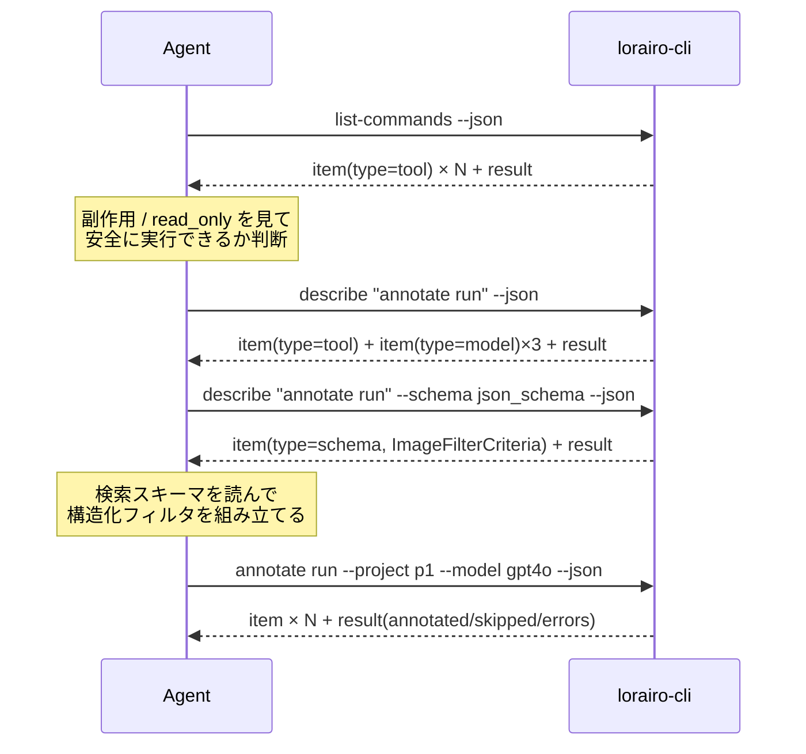
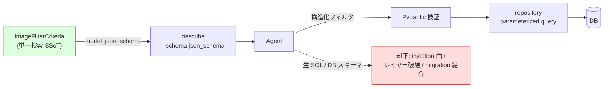
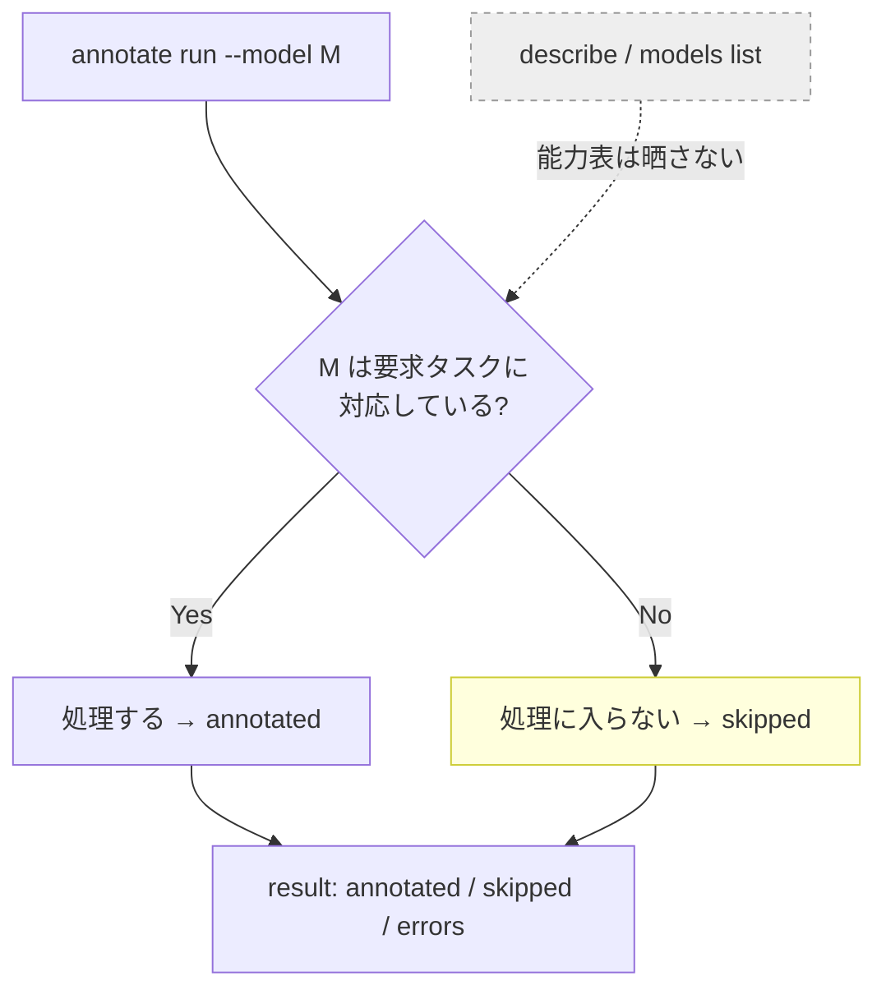

# ADR 0059: CLI Command Introspection Contract

- **関連 Issue**: #634 (epic) / #638
- **関連 ADR**: [0057](0057-cli-jsonl-output-and-error-contract.md) (JSONL 出力 / エラー契約), [0058](0058-cli-output-mode-trigger-and-entrypoint-policy.md) (出力モード / エントリ方針), [0048](0048-webapi-annotation-candidate-filtering.md) (モデル候補フィルタ), [0055](0055-workspace-export-target-staging-unification.md) (検索→ステージング集合), [0056](0056-exact-set-selector-id-count-guard.md) (exact-set 上限)
- **参照**: tag-db ADR 0005 (CLI Command Introspection Contract)

## Context

ADR 0057 と ADR 0058 により、`lorairo-cli` の機械可読(JSONL)出力契約、エラー契約、および出力モードのトリガを定めた。しかし、`lorairo-cli --help` は人間向けの情報であり、エージェントや CI が各コマンドの**入力モデル、出力モデル、副作用の分類**を機械的に取得する契約が存在しない。実行結果は JSONL 化されたものの、**実行前に**「このコマンドが何を受け取り、何を返し、何を書き込むか」を把握する手段が欠けている。

兄弟パッケージの `genai-tag-db-tools`(tag-db)は、tag-db ADR 0005 で `describe` と `list-commands` を導入し、コマンド仕様を専用の `tool` 行・`model` 行の JSONL として公開することでこの課題を解決している。LoRAIro にも同等のイントロスペクション(introspection)を導入する(epic #634)。ただし後述のとおり、ワイヤ表現には tag-db のような専用 `kind` を使わず、ADR 0057 の既存 `item` kind へ載せる。LoRAIro CLI は MCP サーバではなくエージェントフレンドリーな CLI であり、MCP のような厳格なツール定義向けの専用 `kind` をワイヤ契約へ追加する必然性がないためである。

また、LoRAIro は tag-db と以下の点で構造が異なるため、設計をそのまま流用できない。

- **CLI 実装が Typer(Click)ベースである**:入力面はコマンド関数のシグネチャ(`typer.Argument` と `typer.Option`)で構成される。tag-db のように「1 コマンド=1 Pydantic Request」が一対一で揃っているわけではなく、`--json`、`--force`、`--format` といった **CLI 専用フラグ**は `lorairo.public_api` の Request モデルには存在しない。
- **コマンドがネスト構造になっている**:`project list`、`images update`、`annotate run`、`batch ...` などの 6 グループを持つ。tag-db のフラットなコマンド集合とは異なり、イントロスペクションはグループからサブコマンドへのツリー構造を扱う必要がある。
- **検索条件(フィルタ)が単一のドメイン契約へ統一済みである**:GUI の「検索 → ステージング集合 → 各処理」フロー(ADR 0055)が示すとおり、`export`、`annotate`、`images update`、GUI、リポジトリはすべて `database/filter_criteria.py` の `ImageFilterCriteria`(全 23 フィールド)を共有している。CLI の各コマンドはその一部フィールドだけをフラグとして露出しているにすぎず、検索語彙そのものは 1 本に統一されている。
- **出力モデルは Pydantic で整備済みである**:`lorairo.public_api.types` に `ProjectInfo` や `ImageMetadata` などの出力モデルが定義されており、`model_json_schema()` を使ってほぼコストなく出力スキーマを生成できる(tag-db と同型)。

## Scope / Non-Goals

本 ADR では、**イントロスペクションの契約(何を公開し、何を公開しないか)**を固定する。スキーマ生成の具体的な実装機構(Typer / Click のコマンドツリーから導出するか、コマンドごとに Pydantic Request モデルを用意するか)は実装 Issue(#641)で決定し、本 ADR は「**コマンド仕様の SSoT を手書きで複製しない**」という要件レベルにとどめる。

### Non-Goals

- **モデル × タスク能力マトリクスは公開しない**:どのモデルがタグ付け可能か、あるいはスコアリング専用かといったタスク種別の能力表をイントロスペクションで公開し、エージェントへ事前フィルタさせる方式は採らない。非対応モデルは実行時にスキップして `result` の `skipped` 件数で報告する(§5)。`describe` や `models list` を能力表で肥大化させない。実行不能モデルや用途不適モデルの除外は、検出・同期時点の関心事(ADR 0048)であり本 ADR の対象外とする。
- **CLI 入力面の統一は行わない**:検索駆動コマンド(`annotate`、`export`、`images update`)に対して、`ImageFilterCriteria` の全語彙を一律にフラグ展開するか、「検索 → `image_ids` 集合 → 各処理」の二段構え(GUI ステージングの CLI 再現)とするかは、独立した CLI 入力面設計として別 Issue に切り出す。本 ADR は「イントロスペクションが単一の検索スキーマを公開する」点のみを決め、各コマンドの受理方法には踏み込まない。「まず作って不足を補う」反復方針を採る。
- **検索フィルタの新しい統一定義は作らない**:検索語彙はすでに `ImageFilterCriteria` の 1 本に統一されている(Context 参照)ため、新たなフィルタ契約を起こさず既存契約をそのまま公開する。
- **生 SQL および DB スキーマの公開・受理は行わない**(§4 のセキュリティ不変条件)。

## Decision

### 1. `list-commands` と `describe <command>` を追加し、ADR 0057 の既存 `kind` へ載せる

`lorairo-cli list-commands` と `lorairo-cli describe <command>` を追加する。**ADR 0057 が定める `kind` は `item`、`result`、`error` の 3 種類に閉じており(ADR 0057 §2 は進捗用 `event` の追加すら明示的に拒否している)、本 ADR でもこの列挙型は拡張しない。** イントロスペクションには専用 `kind` を追加せず、既存の `item` と終端 `result` で表現する。

この判断は、**LoRAIro CLI が MCP サーバではなくエージェントフレンドリーな CLI である**ことに基づく。MCP のような専用 `tool` / `model` スキーマ `kind` をワイヤ契約へ持ち込む必然性はなく、`describe` と `list-commands` はコマンド情報を列挙する list 系コマンドにすぎない。そのため、ADR 0057 の「list 系=`item` を N 行+終端 `result`」パターンへ素直に乗せられる。tag-db ADR 0005 は専用の `tool` / `model` 行を使うが、LoRAIro は ADR 0057 の `kind` 純度を保つため、この点で意図的に方針を分ける。

- **`list-commands`**:コマンドごとに `kind:"item"` を 1 行(`type:"tool"`、名前・`read_only`・`side_effects` などのメタ情報)出力し、末尾に件数の `kind:"result"` を出力する。
- **`describe <command>`**:対象コマンドの `kind:"item"` 行を以下の構成で出力し、末尾に `kind:"result"` を出力する。
  - `type:"tool"` の `item` 1 行(コマンドのメタ情報)
  - `type:"model"` の `item` 行(入力 `role:"input"`、出力 `role:"output"`、エラー `role:"error"` の各フィールド)
- **`tool` と `model` の区別は `item` ペイロード内の `type` フィールドで行う**(`kind` は `item` のまま維持する)。

ネストしたコマンドは `"images update"` や `"annotate run"` のような**空白区切りのコマンドパス**で表現し、`describe` の引数も同じパス文字列で受け取る。

エージェントがイントロスペクションを用いてコマンドを安全に組み立てる典型的なフローは以下のとおりである。

### 2. 入力・出力・副作用・`read_only` を公開し、スキーマは SSoT から生成する

各コマンドについて、以下の 4 要素を公開する。

- **入力**:コマンドが受け取る引数(名前、型、必須有無、既定値)。検索駆動コマンドの検索条件は、§4 の単一検索スキーマ(`ImageFilterCriteria`)として表現する。
- **出力**:コマンドが返す結果の構造(`lorairo.public_api.types` の Pydantic 出力モデル由来)。
- **副作用**:`db_read`、`db_write`、`file_read`、`file_write`、`network` による分類。
- **`read_only`**:定常状態(ベース DB が存在し、追加書き込みを伴わない状態)において副作用が読み取りのみかどうか。

**スキーマ本体は Pydantic などの SSoT から生成し、CLI 側でフィールド構造を手書き複製しない。** 出力モデルの SSoT は `lorairo.public_api.types`、検索スキーマの SSoT は `database/filter_criteria.py` の `ImageFilterCriteria` とする。入力スキーマを Typer / Click のコマンドツリーから導出するか、コマンドごとに Pydantic 入力モデルを用意するかは実装 Issue(#641)へ委ね、本 ADR では SSoT 単一化の要件のみを固定する。

なお、`side_effects` と `read_only` は**定常状態における分類**とする。コールドキャッシュ時のモデルダウンロードや `--user-db-dir` 相当の条件付き副作用については、注記で補足する(tag-db ADR 0005 と同方針)。

### 3. スキーマ表現モードは `compact`(既定)と `json_schema` の 2 種類とする

`describe` のスキーマ表現は 2 つのモードを提供する。**いずれのモードでも `kind:"item"` 行に載せることで、ADR 0057 の全行 JSONL 不変条件を維持する**(tag-db ADR 0005 のような stdout への非 JSON `#` 行は出力しない)。

- **`compact`(既定)**:フィールドを簡易な型表記(`str (required)`、`int>=1?`、`list[str]?`、`bool=true`)で `type:"model"` の `item` 行へ載せる。入れ子モデルは名前参照とする。人間にもエージェントにも読みやすい既定形式であり、ADR 0057 の「各行を浅く保つ」方針と整合する。
- **`json_schema`**:`model_json_schema()` の完全版を、`type:"schema"` の `item` 行のペイロードへ **1 モデルにつき 1 `item` 行**として埋め込む。生のスキーマを stdout へ直接書かず `item` で包むことで、JSON Schema が深くネストしていても**各行が単一の有効な JSON オブジェクト**であり続け、ADR 0057 の全行 JSONL 契約を破らない。

検索スキーマ(`ImageFilterCriteria`)のように、絞り込める軸・型・制約をエージェントが厳密に読み取りたい場面では `json_schema` モードを利用する。

### 4. 検索語彙は単一の公開フィルタ契約として公開し、生 SQL と DB スキーマは扱わない

検索駆動コマンド(`annotate`、`export`、`images update`)の検索条件は、**単一の公開フィルタ契約 `ImageFilterCriteria` として `describe ... --schema json_schema` で公開する。** エージェントはこのスキーマを読み取り、得意とするスキーマ推論を活用して構造化フィルタを組み立てる。

一方で、**生 SQL も DB スキーマそのものも CLI では受け取らず、公開もしない**(セキュリティ不変条件)。

- 生 SQL の受理は、SQL インジェクションのリスク(`security.md` の生 SQL 文字列連結禁止・ORM 経由必須)、レイヤー破壊(リポジトリやサービス層を迂回する)、およびマイグレーションによる破壊的なスキーマ結合を招くため却下する。
- イントロスペクションが公開するのは、**DB スキーマではなく精査された公開フィルタ契約(`ImageFilterCriteria`)**である。内部カラムを漏らさず、DB マイグレーションを行っても公開契約を安定させられ、エージェントは検証済みの構造化フィルタのみを渡せる。
- CLI は受け取った構造化フィルタを Pydantic などで検証し、リポジトリがパラメータ化クエリ(parameterized query)へ翻訳する。生 SQL が通過する経路は存在しない。

検索語彙はすでに `ImageFilterCriteria` の 1 本へ統一されている(`export`、`annotate`、`images`、GUI、リポジトリが共有)ため、イントロスペクションがこの 1 本を公開すれば、すべての検索駆動コマンドで同じ検索契約を参照できる。

エージェントが読み取るのは **DB スキーマではなく精査された公開フィルタ契約**であり、生 SQL を受け付ける経路は契約上に存在しない。

### 5. モデル能力のミスマッチは実行時スキップへ委ね、イントロスペクションでは公開しない

タグ付け能力を持たないモデルにタグ付けを要求した場合のような**タスク種別の能力ミスマッチは、コマンド実行時に該当モデルをスキップ(処理へ入らない)し、ADR 0057 の `result` の `skipped` 件数として報告する。** イントロスペクションでは「モデル × タスク能力マトリクス」を公開せず、エージェントに事前の能力チェックを強いない。

能力表を `describe` や `models list` に持たせると契約が肥大化するうえ、LiteLLM の機能メタデータの不確実性(ADR 0048 / [[reference_litellm_capability_boolean_unreliable]])をエージェント側へ転嫁することになる。「要求を受け、非対応モデルは実行時に黙ってスキップして `skipped` で報告する」方式の方が契約を薄く保て、挙動も予測しやすい。なお、実行不能モデルや用途不適モデルの除外は、検出・同期時点(ADR 0048)で別途担保する。

## Rationale

- **イントロスペクションを ADR 0057 の既存 `kind` へ載せる理由**:LoRAIro CLI は MCP サーバではなくエージェントフレンドリーな CLI であるため、MCP 的な専用 `tool` / `model` kind をワイヤ契約へ追加する必然性がない。`describe` と `list-commands` は list 系コマンドそのものであり、ADR 0057 の `item`+`result` に自然に適合する。これにより、ADR 0057 が意図的に閉じた `kind` 列挙型(`item` / `result` / `error`)を一切拡張せずに済み、エージェントはイントロスペクションも実行結果も同じ JSONL パーサと `kind` 集合で処理できる。
- **`compact` 既定と `json_schema` 併設の理由**:`compact` は生の JSON Schema より人間が読みやすく、エージェントも解釈しやすい。一方で、検索スキーマの制約を厳密に読み取るなど完全な機械可読性が必要な場面向けに `json_schema` を用意し、深くネストした生スキーマも `type:"schema"` の `item` 行へ 1 モデル 1 行で包むことで全行 JSONL 契約を守る。
- **単一の検索スキーマを公開する理由**:LoRAIro のドメインは「検索 → ステージング → 各処理」(ADR 0055)であり、検索語彙がすでに `ImageFilterCriteria` の 1 本へ統一されている。これを公開することで、エージェントは「ある処理で使えた検索条件を別の処理でも同様に使える」と一貫して理解できる。単一の `search` コマンドを持つ tag-db とは異なり、LoRAIro では検索が複数コマンドに跨る横断契約である点が固有の特徴となる。
- **生 SQL を受けずスキーマ推論を活用する理由**:エージェントのスキーマ推論能力は「公開フィルタ契約を読んで構造化フィルタを組み立てる」形で活かし、SQL インジェクション面、レイヤー破壊、マイグレーション結合を構造的に排除する。
- **能力ミスマッチを実行時スキップへ委ねる理由**:イントロスペクションの契約を薄く保ち、LiteLLM メタデータの不確実性をエージェントへ転嫁しないためである。

## Consequences

- `lorairo-cli` に `list-commands` と `describe` を追加する。コマンドメタ定義(`side_effects`、`read_only`、入出力モデルの対応)がイントロスペクションの正本となるが、フィールドスキーマの正本は引き続き `lorairo.public_api.types`(出力)および `database/filter_criteria.py`(検索)の Pydantic / dataclass 定義に置く。
- 入力スキーマの生成機構(Typer / Click からの導出か Pydantic 入力モデルか)と、`--json`、`--force`、`--format` などの CLI 専用フラグの扱いは実装 Issue #641 で確定する。
- **ADR 0057 の `kind` 列挙型(`item` / `result` / `error`)は拡張しない。** イントロスペクションは専用 `kind` を追加せず `item` と終端 `result` で表現するため、ADR 0057 の改定も、stdout へ非 JSON 行を出力する例外も生じない。`tool`、`model`、`schema` の区別は `item` ペイロードの `type` フィールドで表現し、`docs/cli.md` へ明記する。
- 検索スキーマ `ImageFilterCriteria` は dataclass であるため、`json_schema` 出力には Pydantic ミラーまたは dataclass からのスキーマ生成機構が必要になる(実装 Issue で手法を選定する)。
- **CLI 入力面の統一(検索フラグの全コマンド展開かステージング二段構えか)は別 Issue** として切り出す。本 ADR の確定後に起票し、イントロスペクションが公開する単一検索スキーマを各コマンドがどう受理するかをそこで設計する。
- **タスク能力ミスマッチの実行時スキップと `skipped` 報告**が未実装であれば、`annotate` の挙動案件として実装 Issue で現状を確認し、必要に応じて別途対応する(本 ADR は、その挙動をイントロスペクションから切り離す方針のみを固定する)。
- ADR 0057、ADR 0058、および本 ADR によって epic #634 のイントロスペクション契約が揃い、以降は実装 Issue(#640、#641)へ進む。

## 関連

- ADR 0057(CLI Machine-Readable JSONL Output and Error Contract)— イントロスペクションが載る JSONL 行契約、および `skipped` を含む `result` 契約の供給元
- ADR 0058(CLI Output Mode Trigger and Entry-Point Policy)— `--json` 指定によってイントロスペクションも JSONL 出力となる
- ADR 0048(WebAPI Annotation Candidate Filtering)— 実行不能モデルおよび用途不適モデルの検出・同期時点での除外(本 ADR の Non-Goal「能力マトリクスを公開しない」の前提)
- ADR 0055(Workspace Export Target = Staging Set)— 検索からステージング集合への単一フローが検索語彙統一の根拠となる
- ADR 0056(exact-set selector の大量 ID 集合ガード)— `image_ids` exact-set の上限 500 件
- tag-db ADR 0005(CLI Command Introspection Contract)— 思想の参照元(LoRAIro は Typer・ネスト構造・横断検索契約に対応している点に加え、専用 `tool` / `model` kind を追加せず ADR 0057 の `item` kind へ載せる点でワイヤ表現が異なる)
