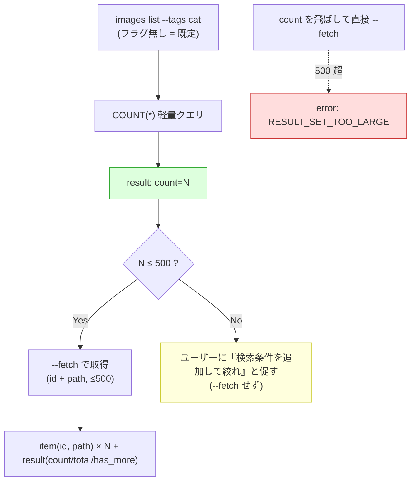

# ADR 0060: CLI Bounded Pagination and Count-First Contract

- **関連 Issue**: #634(epic)/#639
- **関連 ADR**: [0057](0057-cli-jsonl-output-and-error-contract.md)(JSONL・エラー契約・500 件上限 — 本 ADR が上限超過コードを改定)、[0058](0058-cli-output-mode-trigger-and-entrypoint-policy.md)(rich / JSON 出力モード)、[0059](0059-cli-command-introspection.md)(コマンド introspection)、[0049](0049-cli-images-list-db-limit.md)(`images list` の DB 側プッシュダウン)、[0055](0055-workspace-export-target-staging-unification.md)(検索からステージング集合への統一)、[0056](0056-exact-set-selector-id-count-guard.md)(件数のみ取得の軽量化方針)、[0006](0006-pagination-approach.md)(GUI ページネーション)
- **参照**: tag-db ADR 0004 / 0006(上限付きページネーション・フィルタプッシュダウン)

## Context

ADR 0057 §3 では、変更を伴うバッチ操作(`annotate`、`export`、`images update`)に対して 1 回 500 枚の上限を設けた。一方で、読み取り・一覧系コマンドの上限付きページネーション契約は、本 ADR(#639)へ明示的に委譲していた(ADR 0057 §3 末尾)。本 ADR はその契約を確定する。

関連パッケージの `genai-tag-db-tools`(tag-db)は、ADR 0004 および 0006 において、検索の既定 `--limit`、フィルタプッシュダウン、複数 DB をまたぐマージ付きページネーションを整備している。しかし、LoRAIro は tag-db とは前提が異なる。

- **単一 SQLite 構成である**: 複数 DB をまたぐマージ付きページネーションや、リポジトリ単位の上限による取りこぼし問題は存在しない。
- **フィルタはすでに Repository へプッシュダウン済みである**: `ImageFilterCriteria` の条件は `ImageRepository` の SQL に変換される。さらに ADR 0049 により、`images list` の `limit` と `offset` を DB クエリへプッシュダウンし、安定した `Image.id` 順で `(records, total_count)` を返す仕組みが確立済みである。tag-db で問題となった後段フィルタ(フォーマット制約)による取りこぼしも起きない。
- **検索語彙が統一済みである**: 検索条件は単一の `ImageFilterCriteria` に統一されている(ADR 0059 / 0055)。

したがって、LoRAIro のページネーション設計ではプッシュダウン機構そのものよりも、次の 2 点が主眼となる。

1. 大量の検索結果でエージェントや人間の端末を溢れさせないための上限設計
2. その結果を JSONL および人間向け出力でどう表現するかという出力契約

さらに、純粋な CLI として人間が実行する場合と、エージェントが実行する場合とでは、次に取るべき処理が異なる。この違いを「まず件数だけを返す(count-first)」構造で吸収する。

## Scope / Non-Goals

本 ADR では、読み取り・一覧・検索系コマンドにおける上限付きページネーションと count-first の契約を固定する。具体的なフラグ名(`--fetch` など)や出力フィールドの最終確定、Repository クエリの実装詳細は実装 Issue(#640 / #641)に委ねる。本 ADR の範囲は「件数出力を既定とし、実データ取得は明示指定、上限は 500 件、超過時のエラーコードと出力形式」という契約レベルに留める。

### Non-Goals

- **カーソルページネーションは採用しない**: LoRAIro は GUI(ADR 0006)、CLI、`ImageFilterCriteria` のすべてが `limit` / `offset` で統一済みである。カーソル方式を導入する必然性がないため、`limit` / `offset` を踏襲する。
- **大量結果を `offset` で巡回する体験は主眼にしない**: 500 件を超える場合は、次ページを延々と辿るのではなく、検索条件を追加して絞り込む運用に倒す(下記 §4)。
- **件数が小さく固定の一覧(`models list` 等)は対象外とする**: モデルレジストリのように上限が数百件で固定されているコマンドは、件数のみを返さず直接列挙してよい。件数既定と明示取得の対象は、大規模になり得る画像検索系(`images list` やエクスポート対象選択)とする。
- **画像の重いメタデータは検索結果に載せない**: `tags`、`scores`、`captions`、`phash` などは含めない(§2 の出力設計)。
- **フィルタ語彙は再定義しない**: 既存の `ImageFilterCriteria` をそのまま用いる(ADR 0059)。

## Decision

### 1. 件数出力を既定とし、実データ取得を明示フラグにする(count-first の構造化)

検索・一覧系コマンドの既定出力は件数のみとする。実データ(`image_id` とパス)を取得するには、明示的なフラグ(以下 `--fetch` と仮称し、最終名称は実装で確定する)を必要とする。

```jsonc
// 既定 (フラグ無し) = 件数だけ。軽量 COUNT(*)、item 行なし。
// 下は --json (エージェント) 時の JSONL 形。
// count = この応答の item 行数 (count-first は item を出さないので 0)、
// total = 総ヒット数。両モードで count/total の語義を一貫させる (#664 で統一)。
{"kind": "result", "ok": true, "count": 0, "total": 1234, "message": "1,234 件が一致します。"}
```

上記の JSONL は、`--json` 指定時(エージェント向け)の形式である。人間向けの既定モード(rich)では JSONL を出力せず、`1,234 件が一致します。` のような 1 行のメッセージを標準出力へ出す(ADR 0058 に従い、機械可読 JSONL は `--json` または環境変数が有効なときのみ出力する)。以降の件数取得・実データ取得・エラーの各例でも同様に、本 ADR の JSONL 表記は `--json` 時の契約を示し、rich モードでは人間向けの表示とする。

この仕組みにより、count-first が既定挙動として構造的に強制される。エージェントも人間もまず件数を受け取り、500 件以下なら `--fetch` で取得し、500 件を超えるなら取得せずに検索条件の追加を促すという分岐が可能になる。誤って 18,000 行を一気に出力する事態は起き得ない。これは ADR 0056 の件数のみ取得による軽量化方針の延長である。

### 2. 取得時の出力は `image_id` と `file_path` のみとする

`--fetch` が返す項目は、`image_id` と `file_path`(ファイル名またはパス)のみに絞る。`tags`、`scores`、`captions`、`phash` といった重いメタデータは載せない。検索結果には不要であり、表示の視認性を損なうためである。

出力形式は ADR 0058 のモード方針に従って次のように分ける。

- **人間向け(rich 既定)**: 枠付きテーブルは使わず、1 行 1 件のプレーンテキスト `image_id<TAB>file_path`(ID とパスの 2 列)で出力する。500 行あっても `ls -i` や `find` の感覚で読め、コピーや `grep` もしやすい。枠線や色などの装飾は ADR 0058 と同様に表示表現として扱い、本質的にプレーン行であることを契約とする。後段のコマンドへパイプやコピーで渡すステージング ID 集合が欠落しないよう、`image_id` は必ず含める。
- **エージェント向け(`--json`)**: `image_id` と `file_path` を持つ `kind:"item"` の JSONL を N 行出力し、終端に件数メタデータを含む `kind:"result"` を 1 行出力する。

`--fetch` が返す `image_id` 集合は ADR 0055 のステージング集合に相当する。検索から ID 集合を得て、後段コマンドの ID 指定オプション(`batch submit --image-ids` など)へ渡す流れが成立する。

### 3. 基本上限を 500 件に統一し、安定順と DB 側プッシュダウンを必須とする

- **基本上限は 500 件とする**: 読み取り・一覧系にも 500 件上限を適用し、ADR 0057 の処理系 500 件上限と同一値に統一する。「500 件は全操作共通の作業集合上限」という単純な原則にする。
- **ページネーションは `limit` / `offset` を用いる**: `--fetch` 時の既定 `limit` は 500 とする。これにより、上限内の作業集合であれば通常 1 回で全体を取得できる。
- **並び順は安定した `Image.id` 昇順を必須とする**: ADR 0049 で確立した順序を維持し、決定的なページングや分割処理(sharding)を保証する。
- **フィルタ・`limit`・`offset` は Repository クエリへプッシュダウンする**: ADR 0049 に従い、アプリケーション側で全件を実体化してから Python でスライスする実装は採らない。件数取得・実データ取得ともに DB 側で件数を制御する。

### 4. 500 件超過時は `RESULT_SET_TOO_LARGE` で拒否し、件数取得は常に返す

`--fetch` の実行時、フィルタに一致した総件数(`total`)が 500 件を超える場合は、`item` を 1 行も出力する前に `RESULT_SET_TOO_LARGE` の `error` を返して処理を打ち切る。利用者には検索条件の追加を促す。

この上限判定はページ件数ではなく、総ヒット数(`total`)で行う。既定の `limit=500` では返却するページ件数が常に 500 以下になるため、ページ件数で判定するとガードが機能せず「先頭 500 件 + `has_more=true`」が出力されてしまう。`COUNT(*)` で得た総件数が 500 を超えた時点で、ページ取得の前に拒否する。これは §1 の件数出力と同一の判定軸である。

```jsonc
{"kind": "error", "ok": false, "code": "RESULT_SET_TOO_LARGE",
 "message": "1,234 件が一致しました。検索条件を追加して 500 件以下に絞ってください。",
 "retryable": false, "user_action_required": true,
 "details": {"limit": 500, "matched": 1234}}
```

- **既定の件数出力は上限の影響を受けず、何件でも返す**: これが count-first の要点である。エージェントはまず件数を確認して 500 件超過を把握し、`--fetch` を実行する前に絞り込みを促せる。`RESULT_SET_TOO_LARGE` は、件数確認を飛ばして直接 `--fetch` を実行した場合の安全弁となる。
- **専用エラーコードを設ける**: 汎用の `INVALID_INPUT` と分けることで、エージェントは「この 1 コードを受け取ったら絞り込みを促す」と単純に分岐できる。`message` はそのまま人間への案内文として使える(ADR 0020)。
- **処理系の 500 件上限も `RESULT_SET_TOO_LARGE` に統一する**: ADR 0057 の処理系バッチ(`annotate`、`export`、`images update`)の超過コードも、従来の `INVALID_INPUT` から `RESULT_SET_TOO_LARGE` へ変更する。読み取り系と処理系で「500 件超過は同一コード」となり、契約が単純化する(本 ADR の改定節で ADR 0057 を更新)。処理系の回避策(sharding 等)は ADR 0057 §3 のままとする。

### 5. 件数メタデータ

`--fetch` の終端 `result` 行には次の項目を含める。

```jsonc
{"kind": "result", "ok": true, "count": 83, "total": 83,
 "limit": 500, "offset": 0, "has_more": false}
```

- `count`: この応答で出力した `item` 行数(このページの件数)
- `total`: フィルタに一致した総件数(ADR 0049 のサブクエリ `COUNT` で安価に取得済み)
- `limit` / `offset`: 指定値のエコー
- `has_more`: `offset + count < total` の判定結果

これにより、§1 の count-first 既定出力と語義が一貫する。`count` は常に「この応答の `item` 行数」、`total` は常に「総ヒット数」を意味する。count-first 既定出力では `item` を出さないため、`count=0`、`total=N` となる(#664)。総件数が 500 以下であれば、`limit` と `offset` を用いて自由にページングできる。既定 `limit` が 500 のため、通常は 1 回で全件を取得できる。

### count-first フロー



## Rationale

- **件数既定・明示取得の採用**: 安全側(件数のみ)を既定にすることで count-first を構造的に強制し、大量結果の誤出力を不可能にする。人間は「何件一致するか」を即座に把握でき、エージェントは取得前に絞り込みを判断できる。両者の要件を 1 つの構造で吸収できる。
- **`image_id` と `file_path` のみのプレーン行出力**: 検索結果に重いメタデータは不要である。ID はステージングや後続操作への受け渡しに使い、パスは人間の参照に使う。大量の行を扱う場面では、枠付きテーブルよりも `ls` 風のプレーン行のほうが読みやすい。詳細メタデータの取得は検索の責務ではなく、別の個別取得コマンドの関心事とする(YAGNI に従い本 ADR では作らない)。
- **500 件への統一と絞り込み優先**: 「500 件は作業集合の上限」という基準を全操作で一貫させる。18,000 件を `offset` で辿る操作は人間にもエージェントにも非効率であり、条件を足して絞る運用に倒すほうが実用的である。tag-db でも既定上限が導入されている。
- **`RESULT_SET_TOO_LARGE` の新設**: 汎用の `INVALID_INPUT` では引数ミスと区別がつかない。専用コードにすれば、エージェントは 1 コードに対して 1 アクション(絞り込みの案内)で分岐でき、読み取り系と処理系の挙動も揃う。
- **`limit` / `offset` とプッシュダウンの踏襲**: LoRAIro は全レイヤーで `limit` / `offset` に統一されており、フィルタのプッシュダウンも完了している。単一 DB 構成であるため、カーソル方式や複雑なマージ付きページネーションを持ち込む必然性がない。

## Consequences

- 検索・一覧系コマンドは既定で件数を返すように改修する。`images list` は ADR 0049 時点ではレコード出力が既定だったが、本 ADR により件数既定と `--fetch` 明示取得へ変更する。フラグ名と出力フィールドの最終確定は #640 / #641 で行う。
- ADR 0057 のエラーコード一覧に `RESULT_SET_TOO_LARGE` を追加し(14 種から 15 種へ)、処理系 500 件上限の拒否コードを `INVALID_INPUT` から本コードへ統一する(後述の改定節を参照)。ADR 0057 本体への反映は本 ADR が Accepted になった時点で実施し、未承認の変更を確定済み契約へ混ぜないようにした。
- 件数取得は軽量な `COUNT(*)` で実装し、実データ取得とは別経路とする(ADR 0056 の方針の延長)。
- `--fetch` が出力する `image_id` 集合は、ADR 0055 のステージング集合として後段コマンドの ID 指定オプションへ渡せる。#638 で別 Issue に切り出した「検索 → ID 集合 → 各処理」の二段構えが、本 ADR の契約によって素直に成立する。
- 小規模で固定の一覧(`models list` 等)は件数既定の対象外とし、直接列挙を維持する。
- 人間向けの `--fetch` 出力は枠付きテーブルではなくプレーン行とするため、既存の該当 rich Table 表示をプレーン行へ変更する(#641)。
- ADR 0057、0058、0059 および本 ADR により、epic #634 の契約系 ADR が出揃った。残る作業は実装 Issue(#640 / #641)となる。

## ADR 0057 への改定(本 ADR の Accept で適用済み)

本 ADR の Accepted 昇格に伴い、ADR 0057 の §2、§3、§4、§6 を以下のとおり改定した。改定内容の SSoT は本 ADR であり、ADR 0057 本体および README への反映は本 ADR の Accept(本 PR のマージ)と同一コミットで実施した(Proposed の間は確定済み ADR 0057 を編集せず、未確定変更の混入を避けた)。

1. **§4 エラーコード**: `RESULT_SET_TOO_LARGE`(区分: 拡張、`retryable=false`、`user_action_required=true`、主因: 結果が 500 件上限を超過したため検索条件を絞る)を追加し、全 15 種とする。本文中の「全 14 種」も 15 種へ更新する。
2. **§3 500 件上限**: 処理系バッチ(`annotate`、`export`、`images update`)の 500 件超過時の拒否コードを `INVALID_INPUT` から `RESULT_SET_TOO_LARGE` に変更する。回避策(sharding 等)の記述は変更しない。
3. **§6 終了コード**: `RESULT_SET_TOO_LARGE` を終了コード 2(入力・検証エラー)に割り当てる。従来 `INVALID_INPUT` が担っていた上限違反の終了コードを維持し、実行時エラーの終了コード 1 に落とさない。
4. **§3 読み取り・一覧系の扱い**: 「読み取り・一覧系は上限対象外とし、ページネーションは #639 へ委譲する」という記述を具体化する。読み取り・一覧系も基本 500 件で制限するが、処理系の実行前ハード拒否とは異なり、件数既定と明示取得という別形式で実現する。
5. **§2 一覧系の `item` 契約**: 「一覧系は `item` を N 行出力した後に件数サマリの `result` を 1 行出す」という記述を改定する。本 ADR の件数既定に合わせて、「既定(フラグなし)では `item` を出さず `result`(件数)のみを出力し、`--fetch` 指定時に `item` を N 行と終端 `result` を出力する」と具体化し、契約の二重化を防ぐ。

上記 1〜5(§2 / §3 / §4 / §6)は本 ADR の Accept と同一コミットで ADR 0057 本体へ適用済みである。README における ADR 0057 のステータスも「Accepted (amended by 0060)」へ更新済みである。

## Accept 後の改訂(#664)

Accept 後、§1 の count-first の例で `count` を総ヒット数(`count=1234`)として示していたため、§5 の `--fetch` の例における `count`(このページの件数)と語義が二重化していた。CLI 刷新はまだ実運用に入っておらず、出力形式に依存する利用者もいないため、後方互換を考慮せず語義を一本化した。

- `count` は「この応答で出力した `item` 行数」、`total` は「総ヒット数」として両モードで一貫させる。
- count-first の既定出力は `item` を出さないため、`count=0`、`total=N` とする。`--fetch` 時は `count=len(page)`、`total=N` とする。
- §1 の例を `{"count": 0, "total": 1234}` に修正し、§5 にも語義一貫の旨を追記した。これにより、`item` を出力する `project list` や `models list` と語義が揃う。

実装面では、`images list` の count-first 出力を `count=total_count` から `count=0, total=total_count` へ変更した(`introspection.py` の `ImagesListResult` の description でも語義を明示している)。

## 関連

- ADR 0057(CLI Machine-Readable JSONL Output and Error Contract) — 500 件上限とエラーコードの定義元。本 ADR が `RESULT_SET_TOO_LARGE` の追加と上限コード統一により改定する。
- ADR 0058(CLI Output Mode Trigger and Entry-Point Policy) — 人間向け(rich プレーン行)とエージェント向け(JSONL)の出力分離。
- ADR 0059(CLI Command Introspection Contract) — `--fetch` や検索語彙 `ImageFilterCriteria` を `describe` で公開する。
- ADR 0049(Apply CLI Image List Limit in the Repository Query) — `limit` / `offset` の DB プッシュダウン、安定 `Image.id` 順、サブクエリによる総件数取得の機構を確立した。
- ADR 0055(Workspace Export Target = Staging Set) — `--fetch` の `image_id` 集合がステージング集合に相当する。
- ADR 0056(exact-set selector の count-only 軽量化方針) — 件数既定の実装方針の前提。
- ADR 0006(Pagination Approach) — GUI 側の `limit` / `offset` ページネーション(機構統一の根拠)。
- tag-db ADR 0004 / 0006(bounded pagination / filter pushdown) — 思想の参照元。LoRAIro は単一 DB のためマージ付きページネーション問題がなく、count-first・500 件統一・絞り込み誘導の点で設計が異なる。
