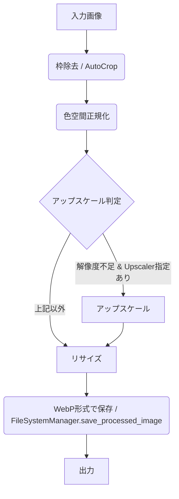

# 画像処理機能 仕様書

## 1. 概要

本ドキュメントは、LoRAIro における画像処理機能の詳細な仕様を定義する。主な処理フローは以下のとおりである。



### モジュール構成

- **コア処理**: `src/lorairo/image_transforms/` パッケージ(#717 で旧 `editor/` から改名)
  - `image_processor.py`: `ImageProcessor`(リサイズ・色空間正規化)、`ImageProcessingManager`(フロー統括)
  - `autocrop.py`: `AutoCrop`(枠除去)
  - `upscaler.py`: `Upscaler`(AI アップスケール)
- **オーケストレーション層**: `src/lorairo/services/image_processing_service.py`(`ImageProcessingService`)
  - GUI や登録処理と `ImageProcessingManager` を仲介し、DB タグ付け、メタデータ保存、`FileSystemManager.save_processed_image` 呼び出しを行う。
  - 詳細は [image_processing_service.md](../application/image_processing_service.md) を参照する。

## 2. 機能詳細

### 2.1. アップスケール(Upscaler)

- **目的**: 低解像度の画像を、指定された AI モデルで高解像度化する。
- **実行条件**: 画像の長辺が `target_resolution` 未満であり、かつアップスケーラーが指定されている場合に実行する。ただし、RGBA モードの画像はスキップする。
- **使用ライブラリ**: `spandrel`、`torch`
- **対応モデル**:
  - `spandrel` ライブラリがサポートするモデルを原則として利用可能とする。
  - モデルリストは設定ファイルの `upscaler_models`(`name`、`path`、`scale` を持つリスト)で管理する。取得には `ConfigurationService.get_upscaler_models()`、`get_upscaler_model_by_name()`、`get_available_upscaler_names()` を用いる。リストには `RealESRGAN_x4plus`(既定スケール:`4.0`)を含む。
- **設定項目(GUI 経由で設定ファイルへ保存)**:
  - 使用するアップスケーラーモデル名(利用可能なモデルから選択)
  - スケール倍率(任意。未指定時はモデル推奨値を使用)
- **メタデータ**: `ImageProcessingManager.process_image` は `processing_metadata`(`was_upscaled`、`upscaler_used`、`upscale_skipped_reason`)を返す。`ImageProcessingService` はこれを受け、DB へ `upscaled` タグを追加し、`upscaler_used` をメタデータとして保存する。
- **注意点**: アップスケールの成否にかかわらず後段の `resize_image` へ進み、常に `target_resolution` 基準へリサイズする(アップスケール結果によるスキップ処理は行わない)。

### 2.2. 枠除去(AutoCrop)

- **目的**: 画像の周囲にある単色またはグラデーションの枠(レターボックス、ピラーボックスなど)を自動検出し、除去する。
- **使用ライブラリ**: `cv2`(OpenCV)、`numpy`
- **検出ロジック(補色差分法)**: `AutoCrop.auto_crop_image` から `_get_crop_area` へ至る単一経路で処理する。
  1. 補色差分画像を生成する。
  2. `_compute_adaptive_threshold_params` が画像サイズと輝度から適応的閾値を自動計算する。
  3. Canny エッジ検出と輪郭検出によって、コンテンツ領域のバウンディングボックスを決定する。
  - ユーザーが設定可能な閾値パラメータは存在せず、すべて適応計算で決定する。
  - 注記:`_evaluate_edge`、`_detect_gradient`、`_detect_border_shape` は旧アルゴリズムの後方互換用デッドコードであり、現行経路からは呼ばれない。
- **クロップ時のマージン**:
  - **実装方式**: 検出されたバウンディングボックスサイズに応じて動的に自動調整する。
  - **計算式**:
    ```python
    margin_x = max(2, int(bbox_width * 0.005))
    margin_y = max(2, int(bbox_height * 0.005))
    ```
  - **設計理由**:
    - バウンディングボックス基準:実際に検出されたコンテンツ領域に対して適切なマージンを適用する。
    - 軸ごとの独立計算:各軸で個別にマージン適用を判定する(`bbox_width > 2 * margin_x`、`bbox_height > 2 * margin_y`)。
    - 安全性チェック:負の寸法を防ぐため、十分な幅や高さがない軸では独立してマージンをスキップする。
    - 最小マージン:2px を下限とし、極小バウンディングボックスを保護する。
  - **計算例**:

    | バウンディングボックス | `margin_x` | `margin_y` | 補足 |
    | --- | --- | --- | --- |
    | 500×500 | 2px | 2px | 両軸で最小値を適用 |
    | 1000×1000 | 5px | 5px | 両軸で比率計算値を適用 |
    | 2000×500 | 10px | 2px | 軸ごとに独立計算 |
    | 1000×3 | 5px | スキップ | Y 軸は `3 <= 4` のため不十分 |
    | 3×1000 | スキップ | 5px | X 軸は `3 <= 4` のため不十分 |
    | 3×3 | スキップ | スキップ | 両軸とも不十分 |

- **処理フロー**: `_get_crop_area` で検出した領域を `PIL.Image.crop` で切り出す。領域を検出できない場合は元画像をそのまま返す。

### 2.3. リサイズ(`ImageProcessor.resize_image`)

- **目的**: 画像を指定ルールに基づき、学習に適した解像度へリサイズする。アスペクト比は維持する。
- **使用ライブラリ**: `PIL`(Pillow)
- **補間アルゴリズム**: `Image.Resampling.LANCZOS`(固定)
- **リサイズルール**:
  1. 入力画像の幅と高さからアスペクト比を計算する。
  2. `preferred_resolutions`(優先解像度・アスペクト比リスト)内に一致するアスペクト比の指定があるか検索する(`_find_matching_resolution`)。
  3. 一致する指定がある場合:`target_resolution` の面積に最も近い優先解像度を採用する。
  4. 一致する指定がない場合:
     - 画像の長辺が `target_resolution` になるよう、アスペクト比を維持して短辺を計算する。
     - 計算した幅と高さを、それぞれ最も近い 32 の倍数へ丸める。
- **設定項目(GUI 経由で設定ファイルへ保存)**:
  - `target_resolution`: 目標解像度(長辺の基準)
  - `preferred_resolutions`: 優先解像度・アスペクト比リスト(例:`[(512, 512), (768, 512)]`)

### 2.4. 色空間正規化(`ImageProcessor.normalize_color_profile`)

- **目的**: 画像の色空間を入力処理に適した形式(RGB または RGBA)へ統一する。
- **対応モード**: `RGB`、`RGBA`、`CMYK`、`P`(パレット)、`L`、`LA`(グレースケール)
- **変換ルール**:
  - `RGB`・`RGBA`: アルファチャンネルの有無に応じて `RGB` または `RGBA` へ変換する。
  - `CMYK`: `RGB` へ変換する。
  - `P`: `RGB` へ変換したあと、再帰的に処理する。
  - `L`・`LA`: アルファチャンネルの有無に応じて `RGB` または `RGBA` へ変換する。
  - その他:未サポートとして警告を出力したあと、`RGB` または `RGBA` へ変換する。

### 2.5. WebP 形式への変換

- **目的**: 処理済み画像を WebP 形式で保存する。
- **実装箇所**: `FileSystemManager.save_processed_image`(`src/lorairo/filesystem.py`)
- **使用ライブラリ**: `PIL`(Pillow)の `save` メソッド
- **設定項目**: 品質・ロスレス設定・圧縮メソッドのユーザー設定は不要である。内部で最適なデフォルト値を使用する。
