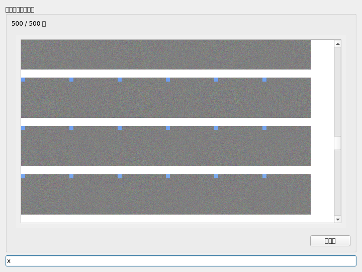

# ステージング・サムネイルのパフォーマンス測定

`test_staging_thumbnail_performance.py` は、`DatasetStateManager` の選択 → `StagingWidget.add_selected_images()` → サムネイル表示までの実経路を測定します。決定論的に生成した 500 枚の 768 × 640 ソース画像 (JPEG と WEBP を交互に配置) を使用します。画像生成とチェックサム検証は計測対象外です。画像リーダーやサムネイルワーカーの mock は使用しません。

シナリオは、500 枚に達するまで 100 枚ずつ追加する操作、初期状態からの 500 枚追加、完了後の幅変更、および追加処理が進行中のキュー済みキーボード入力・スクロール・リサイズで構成されます。各結果には、同期呼び出し時間、表示対象すべての画像読み込み完了までの時間、10 ms ハートビートの最大ギャップ、入力遅延を記録します。幅変更の完了判定は実際のグリッド再配置を待ちます。完了時には、ステージング順に画像 ID とパスを検証し、表示されたすべての pixmap が灰色のプレースホルダーと異なることを確認します。

同じ入力ディレクトリを使い、比較対象のチェックアウトごとに実行してください。worktree で実行する場合は [AGENTS.md](../../AGENTS.md) の共有環境ルールに従い、`uv run --no-sync` を使います。editable インストールが別チェックアウトを指す恐れがある場合は、その worktree の `src` とローカルパッケージの `src` を `PYTHONPATH` に設定してください。

```bash
STAGING_PERF_INPUT_DIR=/tmp/issue-1385-performance/images \
STAGING_PERF_OUTPUT_DIR=/tmp/issue-1385-performance \
STAGING_PERF_LABEL=baseline \
uv run --no-sync pytest tests/performance/test_staging_thumbnail_performance.py \
  --no-cov --timeout=240
```

続いて `STAGING_PERF_LABEL=fixed` で再実行します。JSON 結果内の `manifest_sha256` が一致していれば、両実行が同一の入力バイト列を使った証明になります。各シナリオの `call_ms`、`complete_ms`、`max_gui_gap_ms`、`queued_input.delay_ms` を比較してください。`settled_ms` には末尾のリサイズデバウンスと後続ハートビートを含みます。ソースファイルパスとハッシュには、どのチェックアウト実装を測定したかが記録されます。`queued_input.completed_images` と操作側の `completed_images` により、読み込み完了前に GUI 処理が走ったかどうかを確認できます。PNG スクリーンショットには、ステージング枚数や処理済みキーボード入力を含む完了状態が記録されます。

計測時間は CPU 負荷、ファイルシステムキャッシュ、Qt、画像コーデックの影響を受けます。比較中は他の重い処理を止めてください。新しいウィジェットでアプリ側キャッシュはリセットされますが、ハーネスは OS のファイルシステムキャッシュをフラッシュしません。デフォルトでは、最終的な内容・順序・GUI 入力が正しければ同期ベースラインと非同期実装のどちらも成功します。ローカルの応答性しきい値を強制するには `STAGING_PERF_MAX_GUI_GAP_MS=100` を設定します。各追加の完了前にキーボード入力が処理されること、およびインタラクションシナリオで未完了画像が残っている間にスクロール / リサイズが実行されることを必須にするには、`STAGING_PERF_REQUIRE_INPUT_DURING_LOAD=1` を設定してください。同じハーネスでベースラインも記録できるよう、これらのゲートは任意としています。`slow` と `gui_show` の両マーカーにより、本ハーネスは通常の CI スイートから除外されています。

Linux ではリポジトリのテスト設定が Qt の offscreen プラグインを使用します。そのため、Linux 上の結果は合成的な比較であり、Windows 本番環境の性能証拠にはなりません。Windows での証拠が必要な場合は、Windows 上で別途ハーネスを実行してください。

## Issue #1385 測定結果 (2026-10-10)

環境: Linux / WSL2 offscreen、Python 3.13.15、Qt 6.11.2。ベースラインは `4215b805`、修正版実装は `af4ceede` です。どちらも同じ 500 枚の生成画像を使用しました (マニフェスト SHA256: `0b3937f528c3d2ed4c07f5a02881e21bb0a789df4bdf5303ec0df2e76390bd63`)。ファイルシステムや負荷の揺らぎを含む単独実行の結果であり、Windows の計測値ではありません。

| シナリオ | ベースライン最大 GUI ギャップ | 修正版最大 GUI ギャップ |
| --- | ---: | ---: |
| 100 枚追加 (合計 100) | 1,680 ms | 22 ms |
| 100 枚追加 (合計 200) | 3,157 ms | 23 ms |
| 100 枚追加 (合計 300) | 4,978 ms | 23 ms |
| 100 枚追加 (合計 400) | 6,807 ms | 28 ms |
| 100 枚追加 (合計 500) | 7,917 ms | 47 ms |
| 初期 500 枚追加 | 8,020 ms | 68 ms |
| 500 枚時の幅変更 | 7,920 ms | 16 ms |
| 入力・スクロール・リサイズ付き 500 枚追加 | 8,189 ms | 40 ms |

修正版は 100 ms ギャップゲートおよび読み込み中入力ゲートを有効にした状態で、3 つのシナリオすべてを通過しました。インタラクションシナリオでは、サムネイルバッチが 1 つも届く前の 34 ms 後にキュー済み入力が、40 ms 後にスクロール / リサイズが実行されました。最終的に 500 枚すべての画像が正しい順序で表示されました。画像の読み込み自体はバックグラウンドで時間を要しますが、この測定は画像読み込みの即時化ではなく、GUI イベント処理が途切れず継続することを示しています。

さらに、焦点を絞った回帰テストにより、5 回の追加全体でバックグラウンドの読み込み / スケール呼び出しがちょうど 500 回であること、および既存アイテムの同一性が保たれることを確認しました。幅変更の回帰テストでは、pixmap キャッシュキーを維持したままアイテム位置・シーン寸法・推奨高さのみが更新されることを確認しています。

[ソースハッシュ付きの生測定データ](results/issue-1385.json)


